# Shadowing — Nền tảng luyện nghe nói, phát âm & tiếng Anh toàn diện

Ứng dụng học tiếng Anh mã nguồn mở tích hợp AI, hỗ trợ chạy trên trình duyệt, Docker hoặc đóng gói thành ứng dụng Desktop (Electron) cho Linux, Windows và macOS. Bắt đầu từ việc dán link **YouTube / Vimeo / elllo.org** hoặc chọn **file audio/video trên máy**, Shadowing tách từng câu kèm timing và mở rộng thành hệ sinh thái luyện tập đầy đủ các kỹ năng **Nghe – Nói – Đọc – Phát âm – Ngữ pháp – Từ vựng – Chunks – Thẻ từ Anki**.

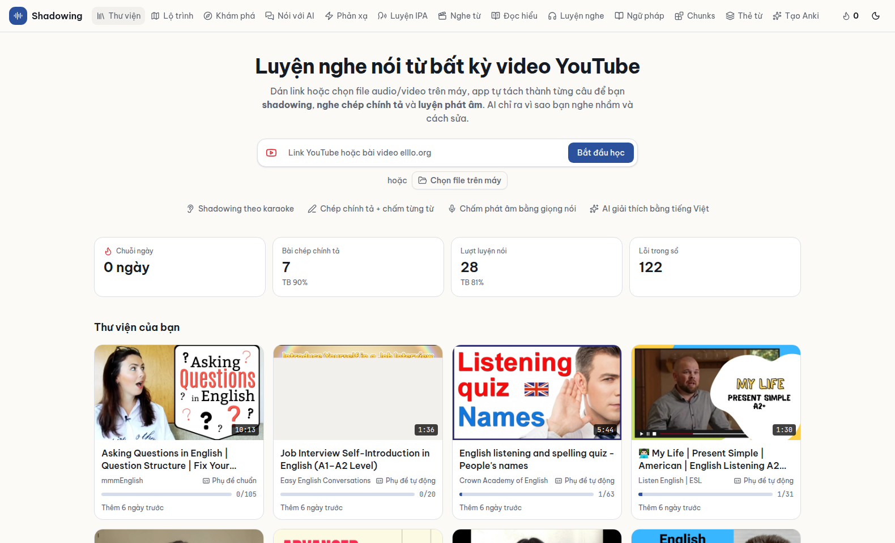

## Mục lục

- [Tính năng nổi bật](#tính-năng-nổi-bật)
  - [1. Học qua Video (Shadowing, Chép chính tả, Phát âm, Từ vựng & Quay bài nộp)](#1-học-qua-video-shadowing-chép-chính-tả-phát-âm-từ-vựng--quay-bài-nộp)
  - [2. Lộ trình học cá nhân hoá AI & Khám phá bài nghe CEFR](#2-lộ-trình-học-cá-nhân-hoá-ai--khám-phá-bài-nghe-cefr)
  - [3. Nói với AI, IELTS Speaking & Phản xạ nói A1–C1](#3-nói-với-ai-ielts-speaking--phản-xạ-nói-a1c1)
  - [4. Luyện IPA, 4 Trụ cột Shadowing & Nghe từ trong video thực tế](#4-luyện-ipa-4-trụ-cột-shadowing--nghe-từ-trong-video-thực-tế)
  - [5. Luyện nghe tự do (Shadcn Rich Editor) & Thư viện đề thi](#5-luyện-nghe-tự-do-shadcn-rich-editor--thư-viện-đề-thi)
  - [6. Đọc hiểu A2–C1 & Ngữ pháp English Grammar in Use](#6-đọc-hiểu-a2c1--ngữ-pháp-english-grammar-in-use)
  - [7. Kho Chunks A1–C1, Thẻ từ FSRS & Tạo thẻ Anki AI](#7-kho-chunks-a1c1-thẻ-từ-fsrs--tạo-thẻ-anki-ai)
  - [8. Sổ lỗi, Thống kê chuỗi ngày học & Tra từ nhanh mọi nơi](#8-sổ-lỗi-thống-kê-chuỗi-ngày-học--tra-từ-nhanh-mọi-nơi)
- [Tech Stack](#tech-stack)
- [Cài đặt & Chạy local](#cài-đặt--chạy-local)
- [Chạy bằng Docker](#chạy-bằng-docker)
- [App Desktop (Electron)](#app-desktop-electron)
- [Cấu hình AI](#cấu-hình-ai)
- [Phím tắt](#phím-tắt)
- [Scripts & Cấu trúc thư mục](#scripts--cấu-trúc-thư-mục)
- [Nguồn dữ liệu & Giấy phép](#nguồn-dữ-liệu--giấy-phép)
- [Lưu ý sử dụng](#lưu-ý-sử-dụng)

---

## Tính năng nổi bật

### 1. Học qua Video (Shadowing, Chép chính tả, Phát âm, Từ vựng & Quay bài nộp)

- **Nhập video linh hoạt**: hỗ trợ link YouTube, Vimeo, bài học `elllo.org` hoặc file audio/video cá nhân. Phụ đề được lấy tự động theo thứ tự: phụ đề tiếng Anh có sẵn (chuẩn / tự động) → file `.srt`/`.vtt` đính kèm → tự tạo bằng **Whisper** (`whisper.cpp` chạy miễn phí trên máy hoặc STT API, luôn hiển thị ước tính thời gian/chi phí trước khi chạy).
- **Chỉnh sửa phân đoạn phụ đề**: tách câu dài, ghép nhiều câu ngắn ngay trong transcript kèm Hoàn tác (Undo) / Làm lại (Redo) và khôi phục bản gốc mà không làm mất lịch sử luyện tập.
- **Shadowing (`/videos/$videoId/shadow`)**:
  - Chữ chạy kiểu karaoke theo timing từng từ, bật/tắt phiên âm **IPA** từng từ và **Dịch tiếng Việt**, chế độ **Shadow không nhìn chữ**, lặp câu và chỉnh tốc độ `0.5×–1.25×`.
  - Hướng dẫn **4 trụ cột Shadowing** (Âm, Trọng âm, Ngữ điệu, Nhịp điệu) và cho phép chọn phần luyện tập trung để AI chấm sát mục tiêu.
  - **Quay video bài nộp cô giáo**: thanh công cụ quay màn hình bài luyện kèm **Webcam Bubble** nổi (bật/tắt camera, kéo thả mọi vị trí, chọn hình tròn/bo góc, kích thước S/M/L), bộ chọn dải câu trực quan (câu hiện tại, đến hết bài, toàn bài hoặc tuỳ chọn dải câu), tự động trộn âm thanh bài học + micro (hỗ trợ cả Linux Desktop PulseAudio/PipeWire) và tải về file `.webm`.

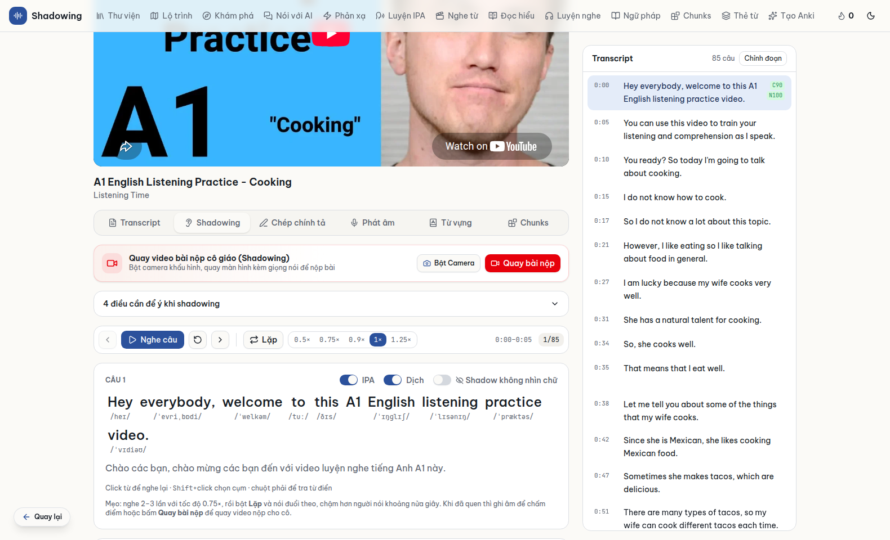

- **Nghe chép chính tả (`/videos/$videoId/dictation`)**:
  - Tự động làm mờ phụ đề trên video và transcript; gõ lại câu vừa nghe và chấm từng từ (`Đúng` / `Sai` / `Thiếu` / `Thừa`), hiểu contraction, số viết bằng chữ và dấu nháy cong.
  - AI giải thích bằng tiếng Việt nguyên nhân nghe nhầm (weak form, nối âm, nuốt âm…).

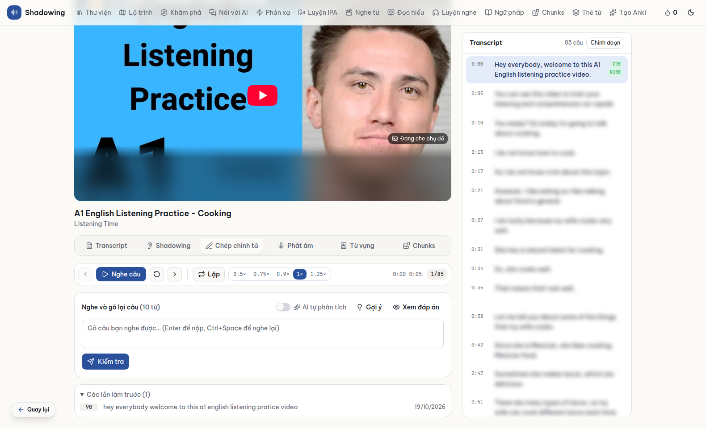

- **Luyện phát âm (`/videos/$videoId/pronounce`)**:
  - Ghi âm đọc đuổi hoặc đọc lặp lại; mặc định **model AI nghe trực tiếp bản ghi** (Gemini, `gpt-audio`…) để bắt chính xác lỗi âm cuối, trọng âm mà STT hay tự sửa, hoặc chọn Whisper (STT) trong Cài đặt.
  - Xem lịch sử luyện tập và mở hộp thoại chi tiết chấm điểm với 4 chỉ số (**Chính xác**, **Đầy đủ**, **Trôi chảy**, **Tốc độ WPM**), bảng `DiffView`, nghe lại bản ghi & câu gốc, nhận xét IPA + mẹo khẩu hình và bài tập luyện lại có nút nghe mẫu.

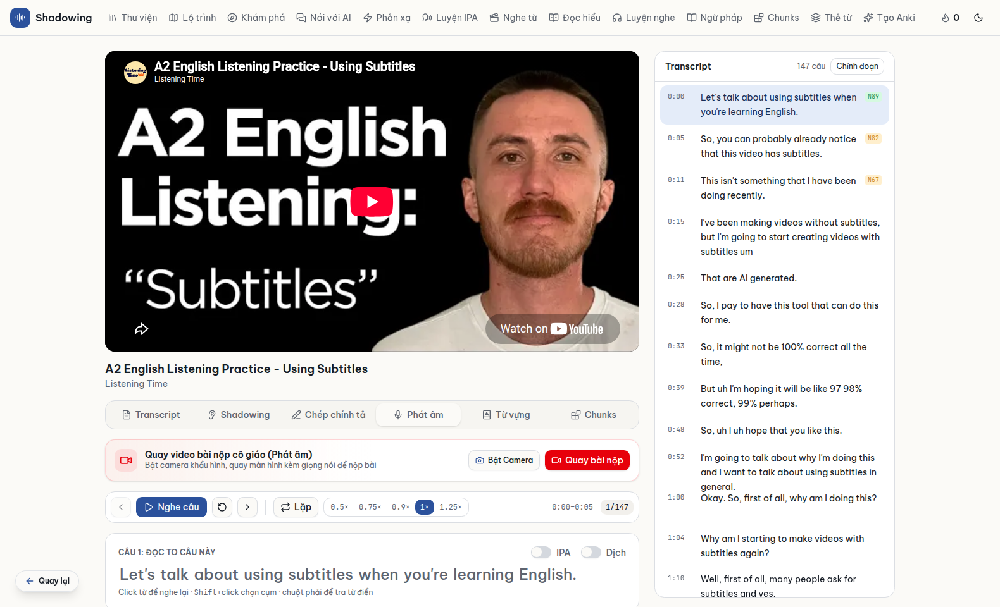

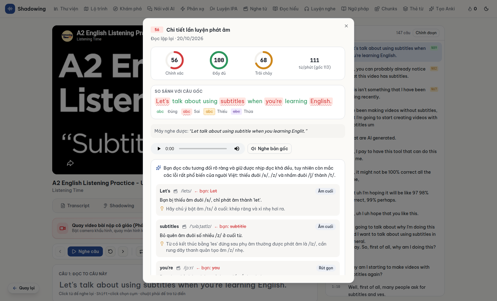

- **Từ vựng & Chunks trong video (`/videos/$videoId/vocab`, `/videos/$videoId/chunks`)**:
  - Phân loại từ vựng theo cấp **CEFR A1–C2**, tìm cụm từ (phrasal verb, thành ngữ, collocation) theo ngữ cảnh bằng AI, luyện nghe và gõ lại từ bị che, lưu hàng loạt vào bộ thẻ riêng của video.
  - Tự động phát hiện các chunks xuất hiện trong phụ đề và bấm vào để nghe lại đúng câu chứa chunk đó.

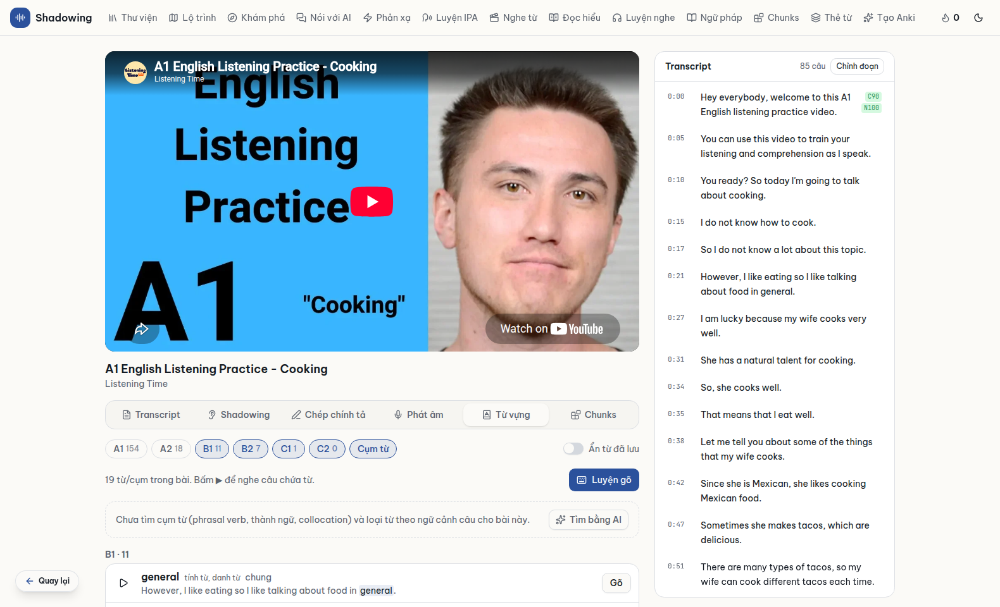

---

### 2. Lộ trình học cá nhân hoá AI & Khám phá bài nghe CEFR

- **Lộ trình học (`/roadmap`)**: nhập mục tiêu, trình độ hiện tại → mục tiêu, thời lượng (tháng/phút mỗi ngày) và kỹ năng ưu tiên; AI thiết kế lộ trình theo **Giai đoạn → Tuần → Từng ngày**, tự động gắn video YouTube/ELLLO, bài Đọc hiểu, Nghe hiểu, Ngữ pháp, Hội thoại, Phản xạ và bộ thẻ từ theo đúng chủ đề nhiệm vụ. Có thể tick hoàn thành, đổi video khác hoặc tạo lại tuần.

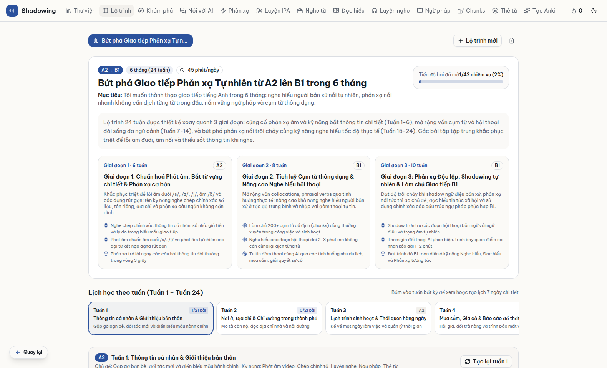

- **Khám phá (`/explore`)**: duyệt kho bài nghe phân theo cấp độ CEFR **A1–C1** từ `elllo.org` (Video, Hội thoại, Ngữ pháp) và tìm kiếm video trực tiếp trên YouTube.

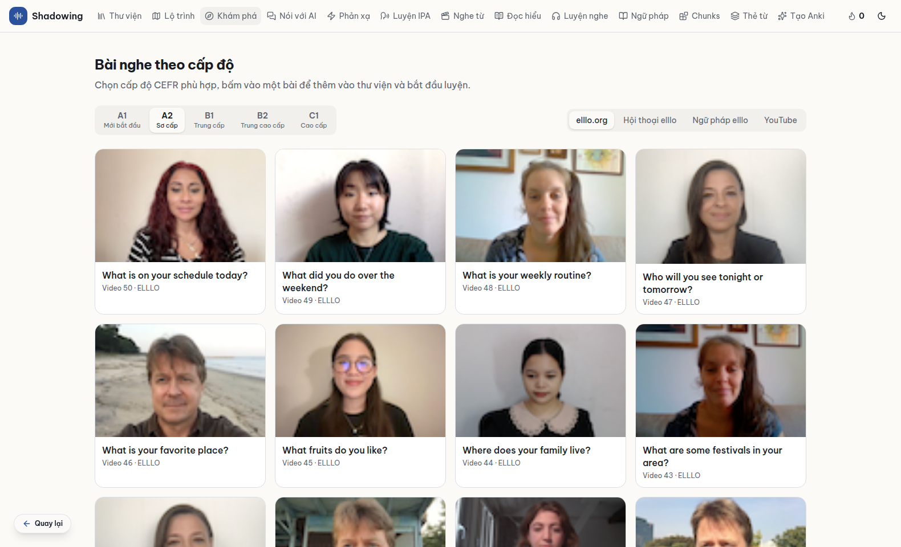

---

### 3. Nói với AI, IELTS Speaking & Phản xạ nói A1–C1

- **Nói với AI (`/talk`)**: nhập vai 8 tình huống đời sống (quán cà phê, nhà hàng, hỏi đường, khách sạn, phỏng vấn xin việc…) hoặc tự nhập chủ đề ở mức A2/B1/B2. Hỗ trợ streaming câu trả lời (hỗ trợ cấu hình riêng Vilao trong Cài đặt), tự đọc to, gợi ý câu trả lời khi bí, và nhận xét cuối buổi kèm câu nên sửa & cụm từ tự nhiên.

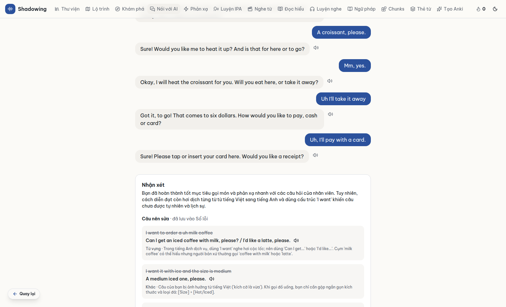

- **Nói theo đề IELTS Speaking (`/speaking`)**: luyện **Part 1**, **Part 2** (22 đề có sẵn hoặc dán đề của bạn; tuỳ chỉnh thời gian chuẩn bị và thời gian nói tối đa) và **Part 3** mở rộng với giám khảo AI. AI ước lượng band tổng và từng tiêu chí (kèm **Pronunciation** khi dùng model nghe trực tiếp audio), chỉ ra các ý đã nói tới, câu nên sửa, từ vựng ăn điểm và viết bài mẫu từ chính ý của bạn.

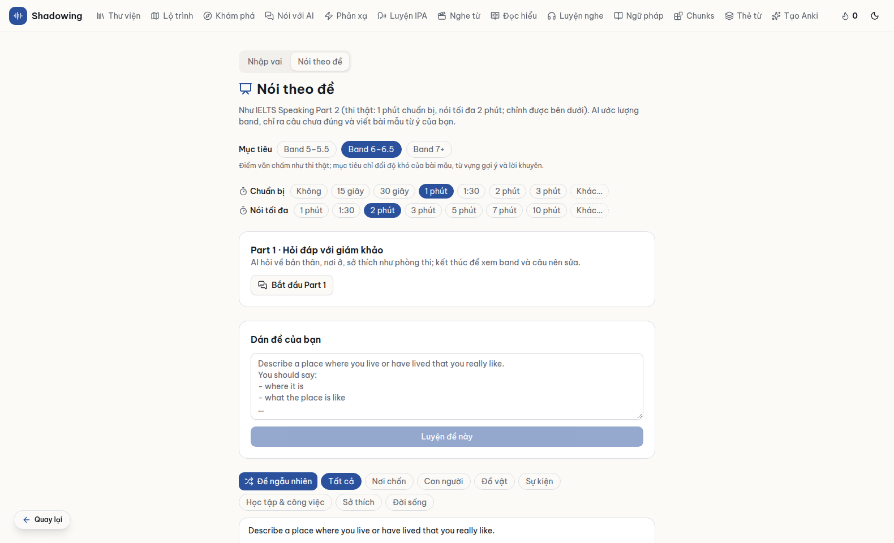

- **Phản xạ nói A1–C1 (`/reflex`)**: 4 dạng bài tập phản xạ nhanh (**Dịch nói Việt → Anh**, **Hỏi nhanh – đáp nhanh**, **Phản xạ tình huống**, **Phản xạ mẫu câu**) lấy đề từ bộ câu sẵn, **Kho Chunks**, >30.000 câu **Tatoeba**, **iTESLj** hoặc AI soạn theo chủ đề. Đề hiện ra là micro tự bật kèm đồng hồ đếm ngược 3–30 giây, đo độ trễ bắt đầu nói (latency) và chấm từng câu ngay lập tức.

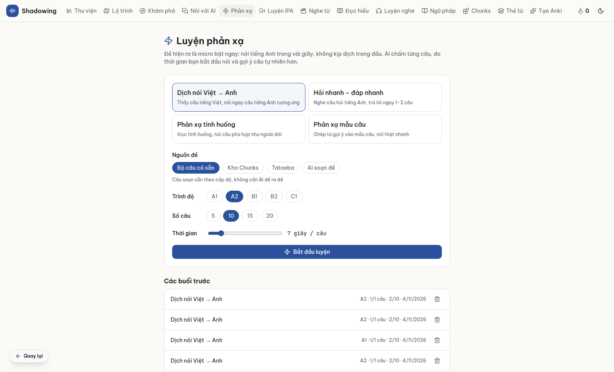

---

### 4. Luyện IPA, 4 Trụ cột Shadowing & Nghe từ trong video thực tế

- **Luyện IPA (`/ipa`)**: bảng 44 âm (nguyên âm đơn, nguyên âm đôi, phụ âm) hỗ trợ chuyển đổi **Giọng Mỹ (US) / Giọng Anh (UK)**; bấm vào từng âm để xem khẩu hình miệng, cặp âm dễ nhầm, video hướng dẫn và tự ghi âm chấm điểm, kèm tab **Luyện nghe** kiểm tra phân biệt âm.

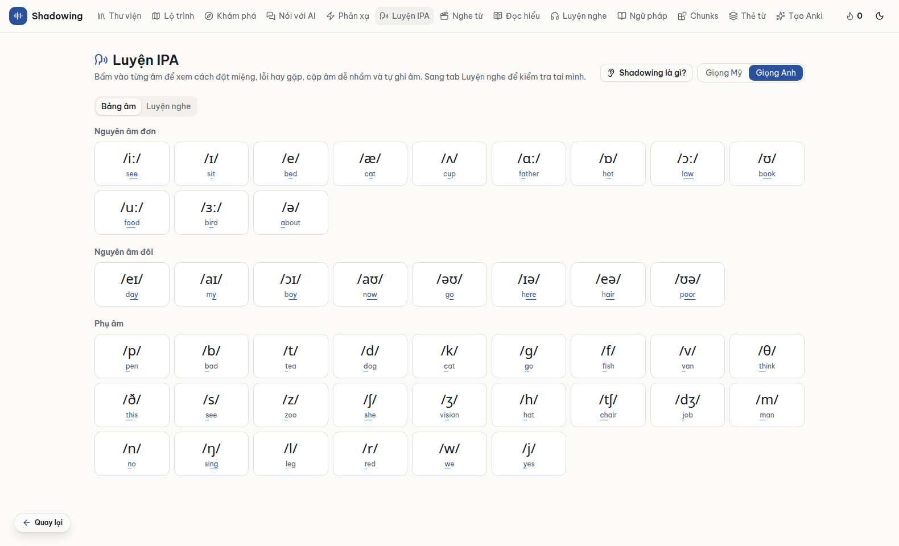

- **Shadowing là gì? (`/ipa/shadowing`)**: bài học tương tác hướng dẫn 4 trụ cột (**Sound**, **Stress**, **Intonation**, **Rhythm**) với câu nghe mẫu (thường / chậm / từng cụm), ghi âm chấm riêng từng trụ cột và tính năng **AI soạn câu luyện theo chủ đề**.

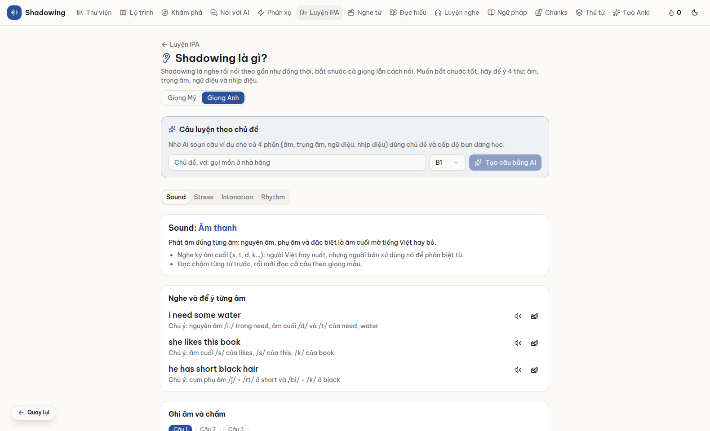

- **Nghe từ trong video (`/pronounce`)**: gõ một từ hoặc cụm từ để nghe người bản xứ phát âm thực tế trong các clip YouTube (tìm trong thư viện cá nhân trước rồi mở rộng tìm trên YouTube), hỗ trợ phím tắt `←` `→` đổi clip, `R` nghe lại và chỉnh tốc độ `0.75×`/`1×`.

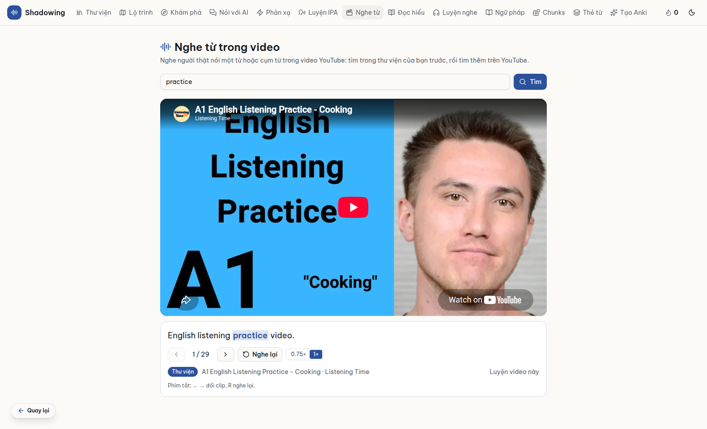

---

### 5. Luyện nghe tự do (Shadcn Rich Editor) & Thư viện đề thi

- **Luyện nghe tự do & Ghi chú bảng (`/listening`)**:
  - Dán link trực tiếp (MP3, M4A, Podcast), link **YouTube** (tự động nhận diện ID và phát qua player nhúng) hoặc chọn file audio từ máy.
  - Trình phát điều khiển chuyên sâu: tua 5 giây (`Alt+←`/`→`), đổi tốc độ `0.75×–1.5×`, phím tắt `Alt+Space` và **Lặp đoạn A–B**.
  - **Shadcn Rich Editor** (Tiptap WYSIWYG) và **Bảng dạng lưới (Grid Table)** hỗ trợ mẫu ghi chú **Neil & Georgie (Cities)** (tiêu đề màu cam đào, gộp ô, thêm/xoá hàng cột), chèn **Mốc thời gian tương tác** (`Alt+M`, bấm để tua audio tới đúng điểm), tự lưu LocalStorage, sao chép HTML dán thẳng sang Word/Google Docs, tải file `.md` và In/xuất PDF.

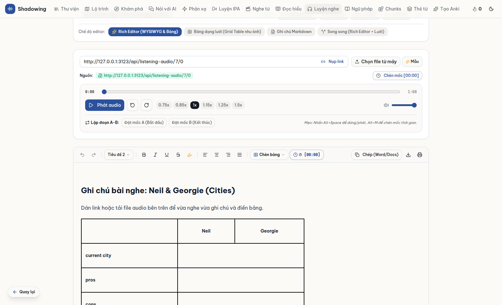

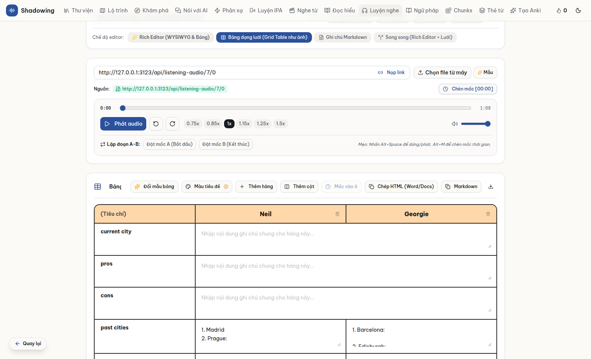

- **Thư viện đề thi Luyện nghe (`/listening`)**: tích hợp đề từ **Cambridge IELTS Listening** (đủ 4 section), **Tactics for Listening**, **Breaking News English**, **Essential English Blog** và **ELLLO**; hỗ trợ chế độ thi thật (nghe 1 lần, ẩn tua/tốc độ/transcript), AI bóc băng bằng Whisper và soạn câu hỏi trắc nghiệm/điền từ.

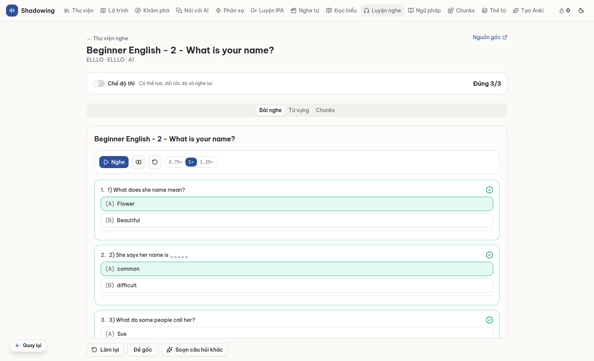

---

### 6. Đọc hiểu A2–C1 & Ngữ pháp English Grammar in Use

- **Đọc hiểu (`/reading`)**: luyện đọc từ **Reading for the Real World**, **Cambridge IELTS 14–18**, **Breaking News English**, **OneStopEnglish**, **Linguapress**, nhờ AI viết bài theo chủ đề hoặc dán văn bản cá nhân. Hỗ trợ dạng đề **Cơ bản**, **IELTS Academic**, **TOEIC Part 7**; bôi đen tô màu 4 màu tự lưu, nhấp đúp tra từ nhanh, chấm điểm kèm giải thích tiếng Việt và đánh dấu câu căn cứ trong bài.

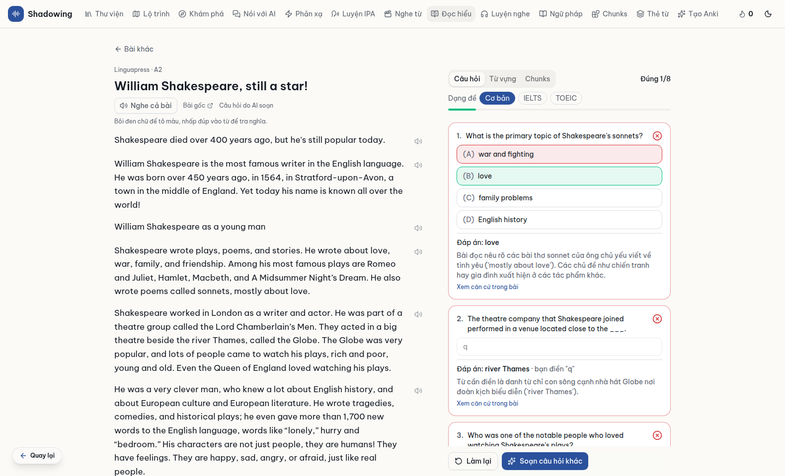

- **Ngữ pháp (`/grammar`)**: trọn bộ **145 unit English Grammar in Use** (kèm Phụ lục), bài tập chấm điểm tức thì, nút **Giải thích tiếng Việt** bằng AI (gồm cả khối **Các dạng câu**: khẳng định, phủ định, nghi vấn kèm công thức & ví dụ nghe được), tab **Luyện thêm (AI)** (5 dạng bài: điền từ, trắc nghiệm, sửa lỗi, sắp xếp, viết lại câu) và tab **Trong video của bạn** để tìm cấu trúc ngữ pháp trong các video đã học.

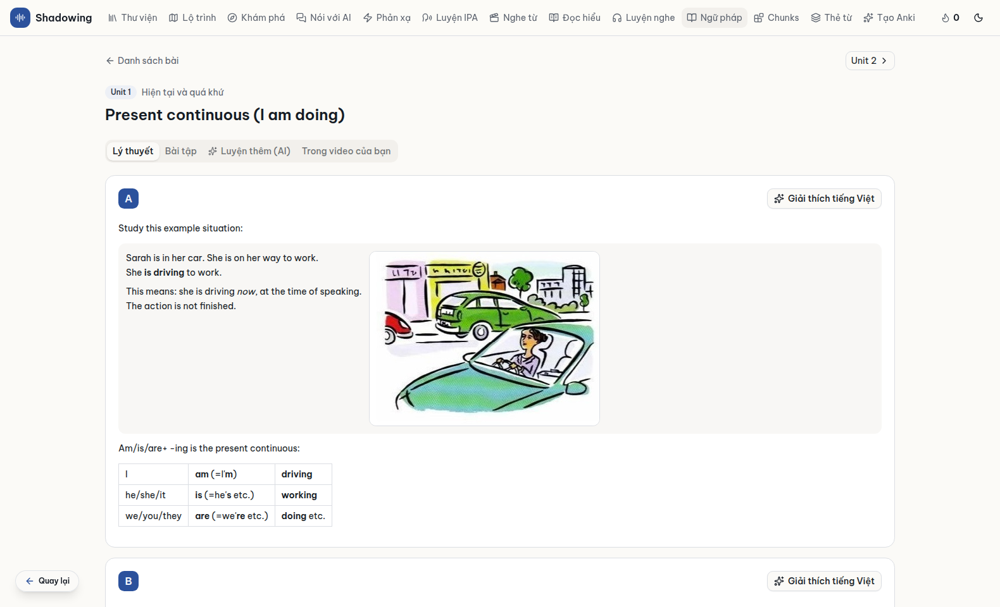

---

### 7. Kho Chunks A1–C1, Thẻ từ FSRS & Tạo thẻ Anki AI

- **Kho Chunks (`/chunks`)**: hơn **8.000 câu và cụm từ** A1–C1 có nguồn Anh–Việt dùng offline (Tatoeba, Open English WordNet), lọc theo cấp độ/chủ đề/loại chunk, nghe phát âm, nói theo để chấm phát âm và lưu thẻ; có mục **Chunks của bạn** (`/chunks/mine`) cho phép nhập PDF hoặc văn bản cá nhân để AI trích xuất chunks.

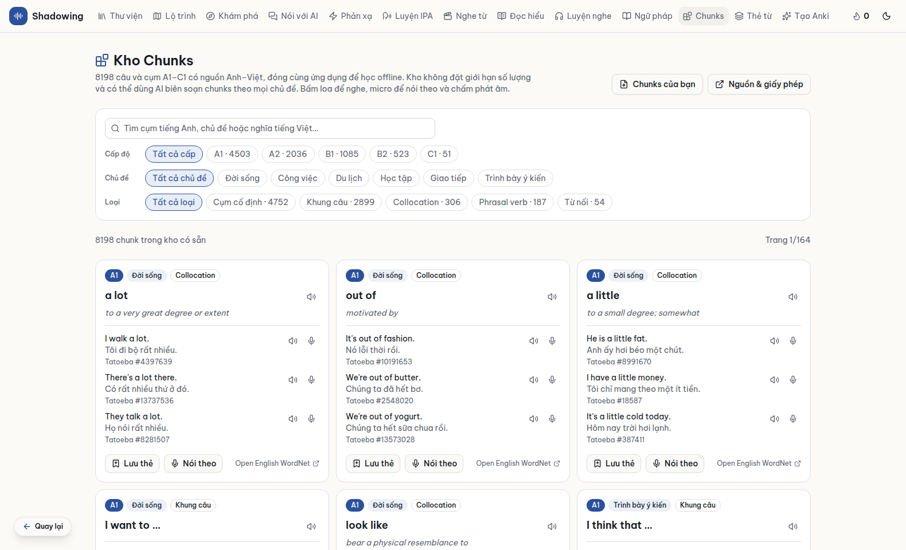

- **Thẻ từ (`/flashcards`)**: ôn tập theo thuật toán **FSRS** (`ts-fsrs`) như Anki; tích hợp thư viện sách từ vựng _Essential English_ chia theo Unit kèm ảnh minh hoạ, IPA và nghĩa tiếng Việt; hỗ trợ chế độ **Lật thẻ** và **Gõ từ** (kèm câu ví dụ Tatoeba), nhập & xuất file `.apkg`.

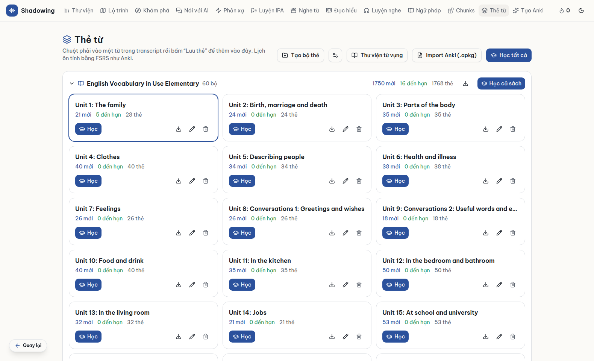

- **Tạo Anki bằng AI (`/anki-builder`)**: chọn sách + unit, dán link bài học hoặc danh sách từ vựng/cụm từ → AI sinh thẻ (nghĩa Việt, IPA, lexical chunks, ví dụ, language notes), tự nhúng ảnh minh hoạ & audio UK/US và xuất thẳng thành file `.apkg` học offline trên Anki.

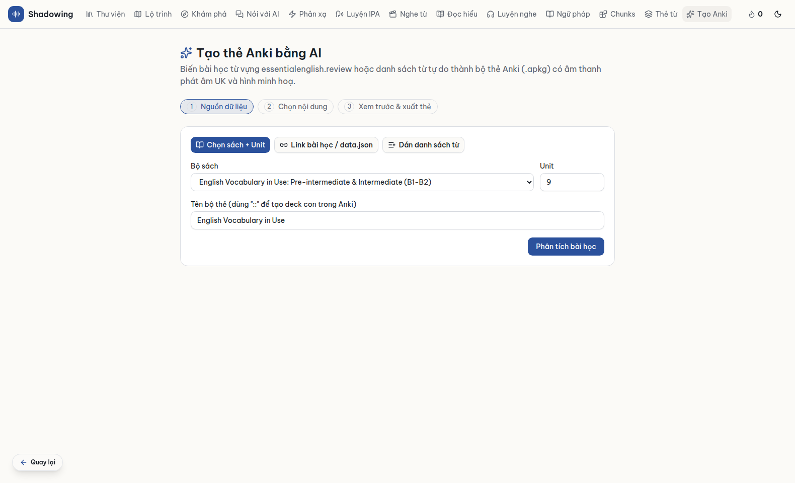

---

### 8. Sổ lỗi, Thống kê chuỗi ngày học & Tra từ nhanh mọi nơi

- **Sổ lỗi (`/review`)**: gom toàn bộ lỗi từ mọi kỹ năng (Chép chính tả, Phát âm, Hội thoại, Nói theo đề, Đọc hiểu, Luyện nghe, Phản xạ, Ngữ pháp) theo từ và loại lỗi; thống kê điểm yếu và có nút bấm để luyện lại đúng câu sai.

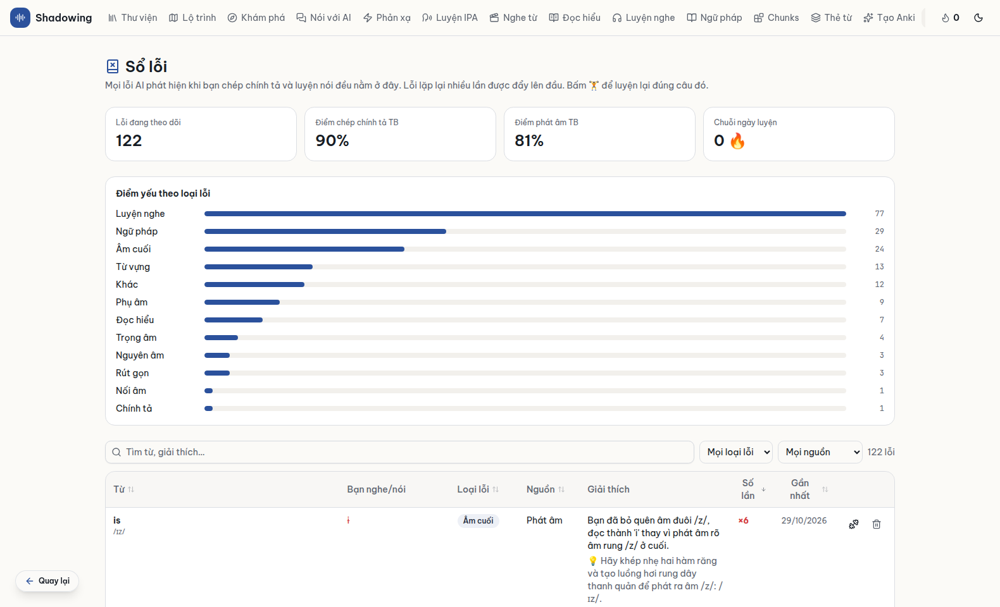

- **Thống kê (`/stats`)**: theo dõi **chuỗi ngày học (streak 🔥)** trên tất cả hoạt động, mục tiêu mỗi ngày, **lịch hoạt động 12 tháng (heatmap)**, biểu đồ điểm trung bình theo tuần và thống kê **mức dùng AI** (số token & lượt gọi theo ngày/tính năng).

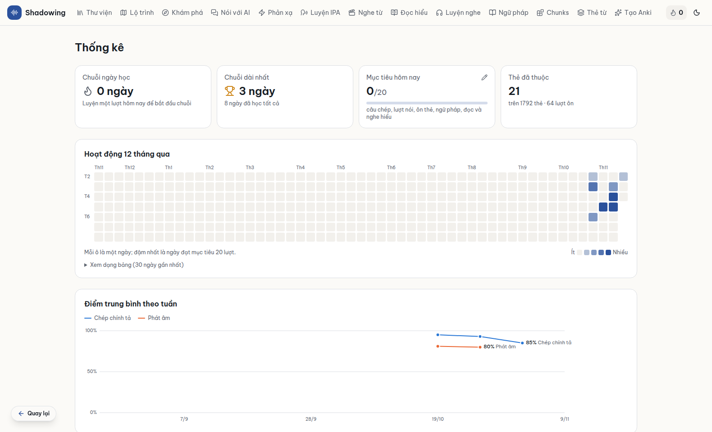

- **Tra từ nhanh ở mọi trang**: nhấp đúp một từ tiếng Anh (hoặc bôi đen một cụm 1–5 từ) tại bất kỳ đâu để mở thẻ tra từ điển Anh–Việt offline kèm IPA, phát âm UK/US, nghĩa AI theo ngữ cảnh câu và nút mở video người bản xứ nói từ đó.

---

## Tech Stack

| Công nghệ                             | Vai trò                                                                                                              |
| ------------------------------------- | -------------------------------------------------------------------------------------------------------------------- |
| **TanStack Start**                    | SSR, Nitro server routes, server functions (`createServerFn`)                                                        |
| **TanStack Router**                   | File-based routing, search params validate bằng Zod                                                                  |
| **TanStack Query**                    | Quản lý dữ liệu server, caching, optimistic mutations                                                                |
| **TanStack DB**                       | Collection sổ lỗi & live query ở client                                                                              |
| **TanStack Form**                     | Form nhập link, ô chép chính tả, trang cài đặt AI                                                                    |
| **TanStack Table v9**                 | Bảng sổ lỗi (sort, global filter, column filter)                                                                     |
| **TanStack Virtual**                  | Render mượt transcript dài hàng trăm câu                                                                             |
| **TanStack Store & Pacer**            | Trạng thái player (thời gian, range, loop, tốc độ) & throttle đồng bộ                                                |
| **TanStack Hotkeys**                  | Phím tắt luyện nghe/nói/thẻ từ                                                                                       |
| **TanStack AI**                       | Adapter đa provider (OpenAI, Anthropic, Gemini, Ollama, OpenAI-compatible) + structured output (Zod) + transcription |
| **React 19 & Tailwind v4**            | Giao diện hiện đại, hỗ trợ Light/Dark mode, shadcn/ui + Radix UI                                                     |
| **Tiptap (`@tiptap/react`)**          | Shadcn Rich Editor WYSIWYG, bảng tuỳ biến, highlight & mốc thời gian                                                 |
| **Drizzle ORM & SQLite**              | Lưu trữ cục bộ (`better-sqlite3`), tự động migrate khi khởi động                                                     |
| **`ts-fsrs` & `fflate`**              | Thuật toán lặp lại ngắt quãng FSRS & đọc/xuất gói `.apkg` Anki                                                       |
| **`yt-dlp`, `ffmpeg`, `whisper.cpp`** | Tải metadata/audio, xử lý media, tạo phụ đề offline trên máy                                                         |

---

## Cài đặt & Chạy local

Yêu cầu **Node.js ≥ 22**, **pnpm** và **yt-dlp bản mới** (bản `yt-dlp` cài qua `apt` thường quá cũ khiến YouTube trả lỗi 400). Nên cài sẵn **ffmpeg** để xử lý audio/video và chấm phát âm trực tiếp.

```bash
pnpm install

# Tải yt-dlp mới nhất vào ./bin (app tự động ưu tiên dùng nếu có)
mkdir -p bin && curl -L -o bin/yt-dlp https://github.com/yt-dlp/yt-dlp/releases/latest/download/yt-dlp_linux && chmod +x bin/yt-dlp

cp .env.example .env   # Tuỳ chọn: điền API key, hoặc cấu hình trực tiếp tại /settings
pnpm dev
```

Mở trình duyệt tại `http://localhost:3000`. Database `data/app.db` được tạo và migrate tự động khi khởi động.

### Tạo phụ đề trên máy bằng Whisper (`whisper.cpp`)

Để tự tạo phụ đề offline cho video không có phụ đề sẵn, cần `cmake` và trình biên dịch C++ để build `whisper-cli` vào `./bin`:

```bash
node desktop/scripts/build-whisper.mjs bin
```

App hỗ trợ 2 model `whisper.cpp` lưu vào `data/models/` (tự tải ở lần dùng đầu tiên hoặc bấm **Tải model** trong `/settings`):

- `large-v3-turbo` (~574 MB, mặc định): chính xác cao, nghe tốt giọng nhanh và tạp âm.
- `small.en` (~265 MB): nhẹ, chạy nhanh trên máy cấu hình yếu.

---

## Chạy bằng Docker

Image Docker đã đóng gói sẵn Node, `ffmpeg` và `yt-dlp`. `yt-dlp` tự cập nhật mỗi lần container khởi động (tắt bằng `YTDLP_AUTO_UPDATE=0`).

Cách nhanh nhất bằng script:

```bash
./install.sh                # Tạo .env nếu chưa có, build, chạy và chờ app sẵn sàng
./install.sh --port 8080    # Đổi cổng (ghi vào .env)
./uninstall.sh              # Xoá container + image, giữ dữ liệu
./uninstall.sh --purge      # Xoá luôn dữ liệu (có hỏi xác nhận)
```

Hoặc dùng Docker Compose thủ công:

```bash
cp .env.example .env        # Tuỳ chọn: điền key, hoặc cấu hình sau ở /settings
docker compose up -d --build
# Mở http://localhost:3000 (đổi cổng: PORT=8080 docker compose up -d)
```

Dữ liệu (`app.db`, bản ghi âm, cache tra từ, media) nằm trong volume `shadowing-data` và được giữ nguyên khi cập nhật image:

```bash
docker compose logs -f                 # Xem log
docker compose up -d --build           # Cập nhật sau khi sửa code
docker compose down                    # Dừng container, giữ nguyên dữ liệu
docker run --rm -v shadowing_shadowing-data:/data -v "$PWD":/backup busybox \
  tar czf /backup/shadowing-backup.tgz -C /data .   # Sao lưu dữ liệu
```

Hoặc chạy container không dùng Compose:

```bash
docker build -t shadowing .
docker run -d -p 3000:3000 -v shadowing-data:/app/data --env-file .env shadowing
```

---

## App Desktop (Electron)

Đóng gói thành ứng dụng Desktop hoàn chỉnh: người dùng tải file cài đặt về mở là chạy, không cần tự cài Node, `yt-dlp` hay `ffmpeg`.

```bash
pnpm --dir desktop install   # Cài dependencies cho desktop (lần đầu)
pnpm desktop                 # Build web + mở app Electron để thử
pnpm desktop:dist            # Tạo file cài đặt cho hệ điều hành hiện tại → desktop/dist/
```

Push tag `v*` lên GitHub để GitHub Actions (`desktop.yml`) tự build đủ `.AppImage` / `.deb` (Linux), `.exe` (Windows) và `.dmg` (macOS) và tạo bản nháp Release.

Kiến trúc Desktop:

- Server TanStack Start chạy bằng chính binary Electron (`ELECTRON_RUN_AS_NODE`) tại `127.0.0.1:47821`.
- `better-sqlite3` được thay bằng bản prebuild cho Electron (`desktop/scripts/prepare-web.mjs`).
- `ffmpeg` đóng gói kèm app (`ffmpeg-static`); `yt-dlp` tự tải ở lần mở đầu và tự cập nhật mỗi lần mở.
- `whisper-cli` được build tự động khi đóng gói (`desktop/scripts/build-whisper.mjs`, cần `cmake`) vào `resources/whisper`.
- Hỗ trợ cấp quyền camera/micro/display-capture để quay video bài nộp ngay trong cửa sổ app (trên Linux tự động ánh xạ nguồn monitor thành thiết bị `DesktopAudio` qua PulseAudio/PipeWire để thu âm thanh bài học cùng giọng nói).
- Dữ liệu lưu tại `~/.config/Shadowing/data` (Linux), `%APPDATA%\Shadowing\data` (Windows), `~/Library/Application Support/Shadowing/data` (macOS).
- App chưa ký số: trên macOS chuột phải → **Open** lần đầu; trên Windows SmartScreen chọn **More info → Run anyway**.

---

## Cấu hình AI

Có thể dùng bất kỳ provider nào tại trang **Cài đặt (`/settings`)** (giá trị lưu trong SQLite và ghi đè `.env`):

| Mục đích                                             | Provider hỗ trợ                                                                                                                                                                                    |
| ---------------------------------------------------- | -------------------------------------------------------------------------------------------------------------------------------------------------------------------------------------------------- |
| **Phân tích lỗi, lộ trình, hội thoại, tạo đề (LLM)** | OpenAI, Anthropic Claude, Google Gemini, Ollama (local), hoặc mọi API chuẩn OpenAI-compatible (OpenRouter, Groq, LM Studio, vLLM…)                                                                 |
| **Nói với AI · Vilao (tuỳ chọn)**                    | Cấu hình API key / Base URL / Model ID riêng cho hội thoại streaming tại `/talk`                                                                                                                   |
| **Chấm phát âm (mặc định `llm-audio`)**              | Chính model LLM ở trên nếu hỗ trợ nghe audio trực tiếp: mọi model Gemini, `gpt-audio` / `gpt-4o-audio`, hoặc proxy hỗ trợ `input_audio` (Claude & Ollama không hỗ trợ audio trực tiếp)             |
| **Speech-to-Text (`stt` hoặc tạo phụ đề API)**       | Bất kỳ endpoint `/audio/transcriptions` chuẩn OpenAI hỗ trợ `verbose_json` + timestamp từng từ: OpenAI `whisper-1`, Groq `whisper-large-v3-turbo`, hoặc `speaches` / `faster-whisper-server` local |
| **Tạo phụ đề offline (`local`, mặc định)**           | `whisper.cpp` chạy trực tiếp trên máy (model `large-v3-turbo` hoặc `small.en`, miễn phí)                                                                                                           |

> Model LLM cần hỗ trợ structured output (JSON schema). Ở chế độ AI nghe trực tiếp (`llm-audio`), bản ghi âm được chuyển sang WAV 16kHz bằng **ffmpeg** rồi gửi qua `input_audio`.

---

## Phím tắt

- **Shadowing / Chép chính tả / Phát âm video**: `Space` phát/dừng · `R` nghe lại câu · `←` `→` câu trước/sau · `L` lặp câu.
- **Ô nghe chép chính tả**: `Enter` nộp bài / chuyển câu tiếp · `Ctrl+Space` nghe lại câu.
- **Nghe từ trong video**: `←` `→` đổi clip · `R` nghe lại clip.
- **Luyện nghe tự do (`/listening`)**: `Alt+Space` phát/dừng · `Alt+←` `Alt+→` tua lùi/tới 5 giây · `Alt+M` chèn mốc thời gian vào ghi chú.
- **Thẻ từ (`/flashcards/study`)**: `Space` / `Enter` lật thẻ / chấm Đạt · `1` `2` `3` `4` chấm mức nhớ · `R` phát âm · `Ctrl/⌘+E` chuyển nhanh giữa Lật thẻ và Gõ từ.

---

## Scripts & Cấu trúc thư mục

```bash
pnpm dev                                      # Khởi động dev server (port 3000)
pnpm build && node .output/server/index.mjs   # Build & chạy bản production
npx vitest run                                # Chạy unit tests
pnpm check                                    # Kiểm tra format Prettier
pnpm lint                                     # Chạy ESLint
pnpm db:generate                              # Tạo Drizzle migration sau khi sửa src/db/schema.ts
pnpm chunks:build                             # Build lại dữ liệu Kho Chunks offline
```

```text
src/
  routes/                 # Các trang ứng dụng: /, /roadmap, /explore, /talk, /speaking,
                          # /reflex, /ipa/*, /pronounce, /reading, /listening, /grammar/*,
                          # /chunks/*, /flashcards/*, /anki-builder, /review, /stats,
                          # /settings, /videos/$videoId/{index,shadow,dictation,pronounce,vocab,chunks}
  server/
    fns/                  # TanStack Start server functions
    ai/                   # Factory provider TanStack AI, prompts, schema Zod, Vilao streaming
    anki/                 # Đọc/xuất gói .apkg Anki
    chunks/, cefr/        # Kho chunks offline & phân loại từ vựng CEFR
    elllo/, youtube/      # Lấy dữ liệu bài học elllo.org & yt-dlp YouTube
    reading/, listening/  # Thư viện đề Đọc hiểu & Luyện nghe
    grammar/, essential/  # Dữ liệu English Grammar in Use & sách Essential English
    reflex/, ipa.ts       # Luyện phản xạ & hướng dẫn phát âm IPA
    captions.ts, stt.ts   # Tạo phụ đề Whisper (whisper.cpp / API) & speech-to-text
    whisper-local.ts      # Quản lý binary whisper-cli & tải model
    media.ts, *-route.ts  # Xử lý ffmpeg & Nitro streaming routes (/api/*)
  db/                     # Drizzle schema & SQLite connection
  lib/                    # Logic dùng chung client/server (align, segment-edit, player-store, srs...)
  components/, hooks/     # UI components (shadcn/ui, Tiptap rich editor, video submission...)
desktop/                  # Mã nguồn Electron app & scripts đóng gói đa nền tảng
docs/screenshots/         # Ảnh chụp màn hình các tính năng trong README
```

---

## Nguồn dữ liệu & Giấy phép

Kho Chunks được xây dựng theo hướng **source-only** (xem chi tiết tại [THIRD_PARTY_CONTENT.md](THIRD_PARTY_CONTENT.md) và trang `/chunks/sources` trong ứng dụng):

- **Tatoeba** (CC BY 2.0 FR): câu tiếng Anh và bản dịch tiếng Việt kèm sentence ID & tác giả.
- **Open English WordNet 2025** (CC BY 4.0): phrasal verb, collocation, từ nối nhiều từ và định nghĩa tiếng Anh.
- **CEFR-J Vocabulary Profile** & **Octanove Vocabulary Profile C1/C2** (CC BY-SA 4.0): gán nhãn cấp độ A1–C1.
- **Mozilla Common Voice** (CC0-1.0, tuỳ chọn): audio người thật đọc khi import thêm bằng `pnpm chunks:import:common-voice`.

---

## Lưu ý sử dụng

- Khi luyện **Shadowing** hoặc **Quay bài nộp**, nên **đeo tai nghe** nếu luyện trên trình duyệt để micro không thu lẫn tiếng video gốc làm lệch điểm chấm.
- Ở chế độ **Whisper (STT)**, mô hình đôi khi tự sửa lỗi phát âm nhẹ; hãy dùng chế độ **Model AI nghe trực tiếp (`llm-audio`)** trong Cài đặt để AI nghe được lỗi âm cuối và trọng âm chính xác hơn.
- Toàn bộ dữ liệu học tập (database `data/app.db`, bản ghi âm `data/recordings/`, file tải lên `data/uploads/`, audio/TTS cache) đều lưu cục bộ trên máy bạn.
